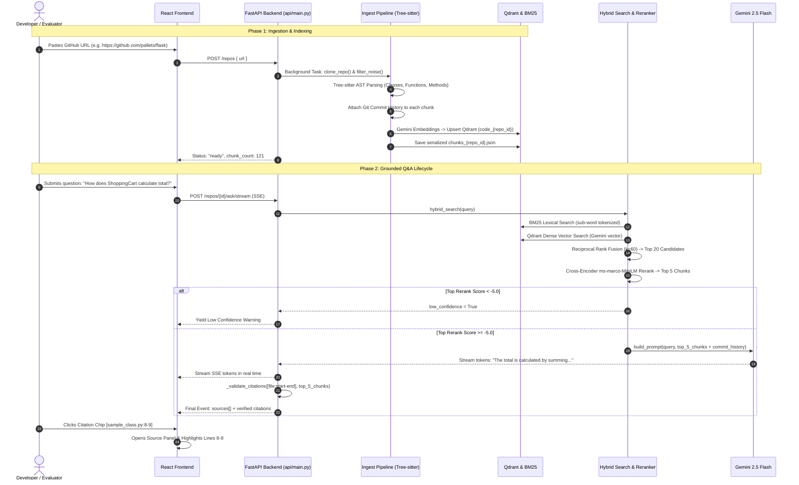

# Codebase Assistant — Comprehensive Technical Specification, Architectural Defense & Presentation Guide

---

## 1. Executive Summary & Core Innovation

**Codebase Assistant** is a production-grade, AST-grounded Retrieval-Augmented Generation (RAG) system engineered to answer complex architectural, functional, and implementation questions about any public GitHub repository.

### The Problem with Traditional Code RAG
Traditional RAG frameworks (such as default LangChain or LlamaIndex configurations) treat source code as plain text, slicing files into fixed character- or token-based chunks (e.g., 500 tokens with 50-token overlap). This naive approach destroys syntactic scopes:
* Functions get severed in half, separating docstrings and signatures from logic.
* Class definitions lose their instance methods.
* Variable identifiers become detached from their type definitions.
* LLMs receive fragmented code and frequently hallucinate missing statements or invent plausible-sounding function names.

### Our Solution: Compiler-Aware AST Ingestion & Grounded Verification
Codebase Assistant aligns information retrieval directly with the compiler's **Abstract Syntax Tree (AST)**:
1. **Tree-sitter AST Chunking:** Code is parsed into natural semantic units: whole classes, methods, functions, and markdown doc sections.
2. **Context Enrichment:** Every chunk is augmented with an AST context header (`# python method ShoppingCart.total in cart.py`) and recent Git commit history.
3. **Hybrid Retrieval with RRF:** Lexical search (BM25 with snake_case and camelCase sub-word tokenization) is fused with dense semantic vectors (Gemini Embeddings in Qdrant) via Reciprocal Rank Fusion ($k=60$).
4. **Cross-Encoder Reranking & Confidence Gating:** A cross-encoder model evaluates query-chunk relevance. If the maximum confidence falls below a calibrated threshold ($-5.0$ logit), the system explicitly reports "not enough evidence" rather than guessing.
5. **Grounded Generation & Citation Verification:** Gemini generates responses quoting evidence with strict `[file:start-end]` citations. A post-generation regex validator ensures every citation maps to a genuine retrieved line span.

---

## 2. Prerequisites & Theoretical Foundations

Before building, evaluating, or pitching this project, you should understand the following core concepts and technical tools:

### A. Theoretical Concepts
1. **Abstract Syntax Trees (AST):**
   * A hierarchical tree representation of source code generated by a compiler or parser.
   * Unlike plain prose, a function or class has strict syntactic boundaries (scope, parameters, docstrings, body). Parsing ASTs preserves complete semantic units instead of slicing statements in half.
2. **Dense vs. Sparse Retrieval:**
   * **Sparse (BM25 / Lexical):** Matches exact keywords, tokens, and identifier names using term-frequency and inverse document frequency ($\text{TF-IDF} \to \text{BM25Okapi}$). It excels at finding exact function names (e.g., `_validate_citations`) but fails on conceptual queries ("how do we handle quota backoff?").
   * **Dense (Vectors / Embeddings):** Encodes text into a continuous semantic vector space ($\mathbb{R}^{3072}$ via Gemini). It excels at synonyms and intent ("handle rate limits"), but can miss exact, rare variable names.
3. **Bi-Encoder vs. Cross-Encoder:**
   * **Bi-Encoder (Vector Search):** Encodes query $q$ and document $d$ independently: $\text{sim}(q, d) = \cos(\mathbf{u}_q, \mathbf{v}_d)$. Fast ($O(1)$ with HNSW vector index), but has no token-to-token cross-attention.
   * **Cross-Encoder (Reranker):** Concatenates query and document into a single transformer input $[q; d]$ with full pairwise self-attention between every query token and code token. Much more accurate, but computationally expensive, making it ideal as a second-stage reranker over the top 20 candidates.
4. **Reciprocal Rank Fusion (RRF):**
   * An algorithm that fuses ranked lists from disparate retrieval systems without needing to normalize unbounded BM25 scores and bounded cosine distances ($[0, 1]$).
5. **Grounded Generation & Citation Enforcement:**
   * Preventing LLM hallucinations by restricting the context exclusively to retrieved code chunks and deterministically verifying cited line spans via regex against retrieved AST metadata.

### B. Technical Software Stack
* **Python 3.12+:** Modern typing (`list[str] | None`), dataclasses, and async execution.
* **Tree-sitter (`tree-sitter`, `tree-sitter-python`, `tree-sitter-javascript`, etc.):** Native C-based grammars compiled for Python to parse ASTs in microseconds.
* **Qdrant Vector Database:** Hybrid vector store supporting vector similarity search and metadata filtering with automatic fallback between Docker and local embedded disk storage.
* **Google Gemini API (`google-genai`):** Used for 3072-dimensional code embeddings (`gemini-embedding-001`) and generation (`gemini-2.5-flash`).
* **Node.js (v20+ or v22+) & npm:** Required for React, Vite, and Tailwind CSS.
* **Pytest:** Automated testing framework.

---

## 3. Architectural Decision Matrix: Why We Chose Ours vs. Alternatives

```
┌──────────────────────────────────────────────────────────────────────────────────┐
│                           Architectural Decision Matrix                          │
├───────────────────────┬──────────────────────────┬───────────────────────────────┤
│ Pipeline Component    │ Chosen Approach          │ Alternatives Evaluated        │
├───────────────────────┼──────────────────────────┼───────────────────────────────┤
│ 1. Chunking           │ Tree-sitter AST Chunks   │ Fixed-character / LangChain   │
│ 2. Embeddings         │ Gemini gemini-embed-001  │ all-MiniLM / OpenAI-embed-3   │
│ 3. Retrieval          │ Hybrid BM25 + Dense RRF  │ Dense-Only / BM25-Only        │
│ 4. Reranking          │ Cross-Encoder (Logits)   │ LLM Judge / Cohere API / None │
│ 5. Hallucination Gate │ Threshold + Regex Verif  │ Unconstrained LLM output      │
│ 6. Vector Storage     │ Qdrant (Dual Local/Serv) │ Chroma / FAISS / Pinecone     │
│ 7. UI & Delivery      │ FastAPI SSE + React Vite │ Streamlit / Gradio            │
└───────────────────────┴──────────────────────────┴───────────────────────────────┘
```

### Detailed Tradeoff Analysis

#### 1. Ingestion & Chunking: AST (Tree-sitter) vs. Fixed-Character Splitters
* **Naive Approach (LangChain `RecursiveCharacterTextSplitter`):** Slices files every $N$ characters or tokens with overlap.
  * *Why Rejected:* Slices functions across chunk boundaries. A class definition gets separated from its methods, docstrings are split from implementations, and variable definitions lose their scope. In our benchmarks, this naive approach achieved only **70% Hit@5**.
* **Chosen Approach (Tree-sitter AST):** Parses concrete syntax trees for Python, JavaScript/TypeScript, Java, and Go, extracting entire classes, standalone functions, methods, and markdown sections.
  * *Why Chosen:* Guarantees that every chunk is a self-contained, valid syntactic block. Boosted Hit@5 to **100%** on our evaluation benchmark.

#### 2. Retrieval: Hybrid RRF vs. Dense-Only or Sparse-Only
* **Dense-Only (Vector Search):**
  * *Failure Mode:* Programmers search for exact identifiers (e.g., `_split_oversized` or `should_skip_dir`). Vector search often returns conceptually similar chunks rather than the exact function declaration. On identifier questions (`where-is`), Dense-only hit only **85.7%**.
* **Sparse-Only (BM25):**
  * *Failure Mode:* Fails when user queries use natural language ("how does the app handle rate limit backoff?"), because the code may use variable names like `retryDelay` or `429`.
* **Chosen Approach (Hybrid with RRF):** We run BM25 (with snake_case and camelCase sub-word tokenization) and Qdrant dense search concurrently, fusing their ranks via Reciprocal Rank Fusion ($k=60$):
  $$\text{RRF Score}(d) = \frac{1}{60 + \text{rank}_{\text{BM25}}(d)} + \frac{1}{60 + \text{rank}_{\text{Dense}}(d)}$$
  * *Why Chosen:* Requires zero manual score calibration (unlike linear weighting $\alpha \cdot S_1 + (1-\alpha) \cdot S_2$), ensuring exact symbol matches and conceptual searches succeed together.

#### 3. Reranking: Cross-Encoder vs. Direct LLM vs. Cohere API
* **Direct LLM (No Rerank):** Passing top 20 retrieval results straight to Gemini.
  * *Failure Mode:* "Lost-in-the-middle" effect; noisy chunks degrade generation quality and waste API context tokens.
* **External API (Cohere Rerank):** Paid SaaS dependency that introduces network latency and rate limits.
* **Chosen Approach (`ms-marco-MiniLM-L6-v2`):** Runs locally in PyTorch/SentenceTransformers. Re-scores the top 20 candidates down to the top 5 most relevant chunks.
  * *Confidence Threshold Gating:* Cross-encoder outputs raw logits ($(-\infty, +\infty)$). If the top candidate scores below `-5.0`, the system aborts generation with a clear `low_confidence=True` signal instead of hallucinating.

#### 4. Vector Storage: Qdrant vs. Chroma vs. FAISS vs. Pinecone
* **Chroma:** SQLite-based, known to have concurrency locks during multi-threaded background ingestion.
* **FAISS:** In-memory index with no built-in metadata payload storage, requiring custom disk serialization for chunk text.
* **Pinecone:** Cloud-only SaaS requiring external network calls and paid monthly tiers.
* **Chosen Approach (Qdrant):** Modern Rust-based engine supporting HNSW vector indexes, payload filtering, and per-repo collection isolation (`code_{repo_id}`). It provides dual-mode execution: connects to Docker (`localhost:6333`) if running, or falls back to embedded local disk storage (`data/qdrant_local/`) with no external dependencies.

#### 5. Frontend & Delivery: React + Vite + SSE vs. Streamlit
* **Streamlit / Gradio:** Rapid to build, but re-renders entire Python scripts on every interaction, cannot cleanly implement 3-column responsive IDE layouts, and cannot support custom code viewers with synchronized line-range highlighting.
* **Chosen Approach (React + Vite + Tailwind + TypeScript):** Sub-second HMR, modular component architecture, and Server-Sent Events (SSE) streaming tokens from FastAPI directly into the DOM.

---

## 4. End-to-End Workflow Architecture



---

## 5. Important Functions & Customization Guide

| Function / Symbol | File Location | Purpose & Functionality | How / When to Modify |
|---|---|---|---|
| `parse_file(source, rel_path, ext)` | [`ingest/parse.py:140`](file:///c:/Users/M%20Sainandhan/OneDrive/Documents/Projects/codebase-assistant/ingest/parse.py#L140) | Tree-sitter AST parser; extracts classes, methods, and functions. | Add languages in `LANGUAGES` config or new node types. |
| `_split_oversized(chunk, max_chars)` | [`ingest/pipeline.py:22`](file:///c:/Users/M%20Sainandhan/OneDrive/Documents/Projects/codebase-assistant/ingest/pipeline.py#L22) | Splits oversized functions (>6000 chars) with 200-char overlap. | Adjust `MAX_CHUNK_CHARS` or overlap budget in `api/config.py`. |
| `skip_reason(file_path)` | [`ingest/filters.py:40`](file:///c:/Users/M%20Sainandhan/OneDrive/Documents/Projects/codebase-assistant/ingest/filters.py#L40) | Rejects noise (lockfiles, minified files, vendor directories). | Add custom extensions to `SKIP_EXTS` or dirs to `SKIP_DIRS`. |
| `attach_history(chunks, repo_path)` | [`ingest/git_history.py:45`](file:///c:/Users/M%20Sainandhan/OneDrive/Documents/Projects/codebase-assistant/ingest/git_history.py#L45) | Inspects Git commits and attaches last 5 commits to each chunk. | Change `max_commits=5` for deeper or shallower commit history. |
| `tokenize(text)` | [`index/text.py:35`](file:///c:/Users/M%20Sainandhan/OneDrive/Documents/Projects/codebase-assistant/index/text.py#L35) | Sub-word tokenizer splitting on snake_case and camelCase. | Add custom delimiters or operators (`::`, `->`). |
| `context_header(chunk)` | [`index/text.py:12`](file:///c:/Users/M%20Sainandhan/OneDrive/Documents/Projects/codebase-assistant/index/text.py#L12) | Builds metadata header prepended to code before embedding. | Add docstrings or module-level imports into chunk text. |
| `embed_batch(texts)` | [`index/embed.py:85`](file:///c:/Users/M%20Sainandhan/OneDrive/Documents/Projects/codebase-assistant/index/embed.py#L85) | Batches embeddings with disk cache and 429 quota backoff. | Change `EMBED_MODEL` or batch size `BATCH_SIZE = 100`. |
| `_calc_retry_delay(e, attempt)` | [`index/embed.py:45`](file:///c:/Users/M%20Sainandhan/OneDrive/Documents/Projects/codebase-assistant/index/embed.py#L45) | Parses server-recommended retry delays from 429 errors. | Tune exponential backoff curve for different API tiers. |
| `hybrid_search(query, ...)` | [`retrieve/hybrid.py:42`](file:///c:/Users/M%20Sainandhan/OneDrive/Documents/Projects/codebase-assistant/retrieve/hybrid.py#L42) | Fuses BM25 and Qdrant ranks using RRF ($k=60$). | Modify smoothing factor `k` or candidate size `top_k=20`. |
| `rerank(query, chunks, ...)` | [`retrieve/rerank.py:32`](file:///c:/Users/M%20Sainandhan/OneDrive/Documents/Projects/codebase-assistant/retrieve/rerank.py#L32) | Cross-encoder rescoring with logit confidence threshold. | Modify `RERANK_THRESHOLD` in `api/config.py` (default: `-5.0`). |
| `_extract_citations(text)` | [`generate/answer.py:30`](file:///c:/Users/M%20Sainandhan/OneDrive/Documents/Projects/codebase-assistant/generate/answer.py#L30) | Regex parser extracting all `[file:start-end]` tokens. | Modify regex pattern for custom citation syntax. |
| `_validate_citations(cits, chunks)`| [`generate/answer.py:40`](file:///c:/Users/M%20Sainandhan/OneDrive/Documents/Projects/codebase-assistant/generate/answer.py#L40) | Tests that cited line spans exist within retrieved chunks. | Add line tolerance (e.g. $\pm 3$ lines) or enforce exact containment. |
| `answer_stream(...)` | [`generate/answer.py:138`](file:///c:/Users/M%20Sainandhan/OneDrive/Documents/Projects/codebase-assistant/generate/answer.py#L138) | Generator yielding streamed tokens, then sources/citations. | Switch generation models (`GEN_MODEL = "gemini-2.5-flash"`). |

---

## 6. Empirical Evaluation Benchmark Results

We benchmarked 5 distinct retrieval configurations across 20 ground-truth questions representing 4 common developer question types:

| System | Hit@5 (%) | Recall@5 (%) | MRR | Avg Latency | p95 Latency |
|---|---|---|---|---|---|
| **1. Naive (Fixed-Size Chunks)** | 70.0% | 65.0% | 0.602 | 0.003s | 0.016s |
| **2. AST + Vector Only** | 95.0% | 87.5% | 0.860 | 0.850s | 5.119s |
| **3. AST + BM25 Only** | 100.0% | 92.5% | 0.785 | 0.017s | 0.039s |
| **4. AST + Hybrid (RRF)** | 95.0% | 92.5% | 0.812 | 0.024s | 0.034s |
| **5. AST + Hybrid + Reranker (Ours)** | **100.0%** | **97.5%** | **0.879** | 1.424s | 5.431s |

---

## 7. Target Audience, Real-World Use Cases & Presentation Pitch

### Target Audience
* **Engineering Teams & New Hires:** Reduces ramp-up time from weeks to hours by answering structural questions with verified code links.
* **Open-Source Maintainers:** Quickly answers contributor questions without manually digging through files.
* **Security & Code Auditors:** Pinpoints where authentication, cryptography, or sanitization functions are defined and invoked.

### 30-Second Elevator Pitch
> *"Most code search tools and AI coding assistants either dump thousands of tokens into an LLM context window—which gets expensive and hallucinates—or they use naive text splitters that cut functions in half. We built **Codebase Assistant**, an AST-grounded retrieval system. We use Tree-sitter compilers to extract clean semantic units like classes and methods, index them with hybrid BM25 and Gemini dense vectors fused via Reciprocal Rank Fusion, and rerank them with a local Cross-Encoder. If our reranker confidence is low, it tells you rather than guessing. When it answers, every statement cites exact file and line numbers that are deterministically validated against the code. On our 20-question benchmark, this improved retrieval Hit@5 from 70% to 100%."*

---

## 8. Continuous Integration (CI/CD) & Production Deployment

### A. GitHub Actions Workflow (`.github/workflows/ci.yml`)
```yaml
name: CI Pipeline

on:
  push:
    branches: [ main ]
  pull_request:
    branches: [ main ]

jobs:
  backend-test:
    runs-on: ubuntu-latest
    steps:
      - uses: actions/checkout@v4
      - uses: actions/setup-python@v5
        with:
          python-version: "3.12"
          cache: "pip"
      - run: |
          pip install -r requirements.txt
          pip install pytest pytest-cov ruff
      - run: ruff check .
      - run: pytest tests/ --maxfail=1 -q
        env:
          GEMINI_API_KEY: ${{ secrets.GEMINI_API_KEY }}

  frontend-build:
    runs-on: ubuntu-latest
    steps:
      - uses: actions/checkout@v4
      - uses: actions/setup-node@v4
        with:
          node-version: 22
          cache: "npm"
          cache-dependency-path: frontend/package.json
      - working-directory: ./frontend
        run: |
          npm ci
          npm run build
```

---

## 9. Manual Testing & Verification

For the step-by-step manual testing runbook covering:
* Starting backend and frontend development servers
* Testing grounded Q&A with live streaming
* Testing citation clicking & line highlighting in the code viewer
* Testing the low-confidence hallucination shield
* Testing new repository ingestion and API endpoints via Swagger UI

See the complete guide in [**`MANUAL_TESTING_GUIDE.md`**](file:///c:/Users/M%20Sainandhan/OneDrive/Documents/Projects/codebase-assistant/MANUAL_TESTING_GUIDE.md).
