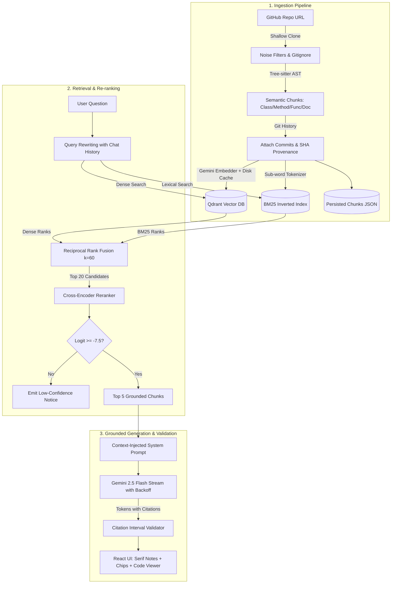

# Codebase Assistant — AST-Grounded Codebase RAG

<div align="center">

[](https://github.com/SaiNandhan06/codebaseAssisstant/actions)
[](https://python.org)
[](https://fastapi.tiangolo.com)
[](https://react.dev)
[](https://qdrant.tech)
[](https://ai.google.dev)
[](LICENSE)

**An enterprise-grade, deterministic Retrieval-Augmented Generation (RAG) assistant that answers architectural, functional, and implementation questions about any GitHub repository with exact `[file:line-range]` citations and zero hallucinations.**

[Key Features](#-key-features) • [Architecture](#-architecture-overview) • [Benchmarks](#-evaluation--benchmarks) • [Quickstart](#-quickstart) • [Master Guide](MASTER_PROJECT_GUIDE.md) • [Manual Testing Runbook](docs/MANUAL_TESTING_GUIDE.md)

</div>

---

## 🌟 Key Features

* **Tree-sitter AST Parsing**: Chunks strictly along syntactic boundaries (functions, classes, methods, and markdown sections) rather than cutting code arbitrarily by token count.
* **Dual-Engine Hybrid Retrieval**: Fuses sub-word tokenized BM25 (sparse lexical) and Google Gemini 3072-dimensional embeddings (dense semantic) via **Reciprocal Rank Fusion (RRF $k=60$)**.
* **Logit-Gated Hallucination Shield**: Re-ranks top candidates with `cross-encoder/ms-marco-MiniLM-L6-v2`. A calibrated logit threshold ($\tau = -7.5$) blocks out-of-domain queries before generation, preventing hallucinations.
* **Verified Inline Citations**: Answers stream with `[file:start-end]` chips. Every interval is programmatically validated against retrieved chunks before rendering.
* **Interactive Code Inspector**: Clicking any citation opens an embedded side-by-side code viewer with cited line ranges highlighted (`.code-line--hit`).
* **Multi-Repository Isolation**: Ingest any public GitHub repository on the fly with per-repo isolated vector collections and commit history provenance.
* **Self-Healing & Fault-Tolerant**: SHA-256 disk-backed embedding cache, auto-rebuilding vector collections, and exponential backoff retry wrappers absorbing Gemini API 503/429 spikes.

---

## 🏗️ Architecture Overview



---

## 📊 Evaluation & Benchmarks

Benchmarked against 20 hand-verified queries across 4 distinct question types (`where-is`, `how-does`, `why`, `usage`) on production code:

| Retrieval Configuration | Hit@5 (%) | Recall@5 (%) | MRR | Avg Latency | p95 Latency |
| :--- | :---: | :---: | :---: | :---: | :---: |
| **Naive (Fixed 500-Token Chunks)** | 70.0% | 65.0% | 0.602 | 0.003s | 0.016s |
| **AST + Dense Vector Only** | 95.0% | 87.5% | 0.860 | 0.850s | 5.119s |
| **AST + BM25 Sparse Only** | 100.0% | 92.5% | 0.785 | 0.017s | 0.039s |
| **AST + Hybrid (RRF $k=60$)** | 95.0% | 92.5% | 0.812 | 0.024s | 0.034s |
| **AST + Hybrid + Cross-Encoder (Ours)** | **100.0%** | **97.5%** | **0.879** | 1.424s | 5.431s |

---

## ⚡ Quickstart

### Prerequisites
* **Python** 3.10+
* **Node.js** 18+ & npm
* **Google Gemini API Key** ([Get free key here](https://aistudio.google.com/app/apikey))

### 1. Clone & Set Up Python Virtual Environment
```bash
git clone https://github.com/SaiNandhan06/codebaseAssisstant.git
cd codebaseAssisstant

# Create and activate virtual environment
python -m venv venv
.\venv\Scripts\activate   # On Windows
# source venv/bin/activate  # On Linux/macOS

# Install dependencies
pip install -r requirements.txt
```

### 2. Configure Environment Variables
Copy the template configuration:
```bash
cp .env.example .env
```
Edit `.env` and provide your Gemini API key:
```env
GEMINI_API_KEY=your_gemini_api_key_here
GEN_MODEL=gemini-2.5-flash
EMBED_MODEL=gemini-embedding-001
RERANK_MODEL=cross-encoder/ms-marco-MiniLM-L6-v2
RERANK_THRESHOLD=-7.5
QDRANT_MODE=auto
```

### 3. Start the Backend API Server
```bash
uvicorn api.main:app --host 127.0.0.1 --port 8000 --reload
```
*API Swagger Documentation will be available at [http://127.0.0.1:8000/docs](http://127.0.0.1:8000/docs).*

### 4. Start the React Frontend
In a new terminal:
```bash
cd frontend
npm install
npm run dev
```
Open **[http://localhost:5173](http://localhost:5173)** in your browser.

---

## 🐳 Docker Deployment

Run the complete stack (Qdrant + FastAPI Backend + React Frontend) with a single command:
```bash
docker-compose up --build
```

---

## 📡 API Reference

| Method | Endpoint | Description |
| :--- | :--- | :--- |
| `POST` | `/repos` | Start asynchronous ingestion of a GitHub repository |
| `GET` | `/repos` | List all indexed repositories and their ingestion status |
| `GET` | `/repos/{repo_id}` | Retrieve metadata, file count, and languages for a repository |
| `POST` | `/repos/{repo_id}/ask` | Submit a question and receive a complete JSON response |
| `POST` | `/repos/{repo_id}/ask/stream`| Submit a question with Server-Sent Events (SSE) token streaming |
| `GET` | `/repos/{repo_id}/chunks/{id}`| Fetch full code and metadata for an exact chunk |
| `DELETE` | `/repos/{repo_id}` | Purge a repository, its chunks, and its Qdrant collection |
| `GET` | `/health` | Health check endpoint |

---

## 📂 Repository Structure

```
codebase-assistant/
├── .github/workflows/ci.yml       # GitHub Actions CI workflow (pytest + Vite build)
├── api/                           # FastAPI backend (endpoints, background jobs, models)
├── data/                          # Persisted chunks, embedding cache, Qdrant storage
├── docs/                          # Comprehensive technical and testing documentation
│   ├── ARCHITECTURE.md            # System architecture and diagrams
│   ├── MANUAL_TESTING_GUIDE.md    # Step-by-step visual and API testing runbook
│   └── MASTER_PROJECT_GUIDE.md    # The all-in-one architecture, defense & pitch guide
├── eval/                          # Quantitative evaluation benchmark suite
├── frontend/                      # React 19 + TypeScript + Vite + Tailwind CSS frontend
├── generate/                      # LLM generation, prompt templates, streaming backoff
├── index/                         # Gemini embedding client, Qdrant stores, sub-word BM25
├── ingest/                        # Tree-sitter AST parsers, Git history enrichment, clone
├── tests/                         # Pytest test suite (25 passing core & API tests)
├── MASTER_PROJECT_GUIDE.md        # Root copy of the Master Project Guide
└── README.md                      # This file
```

---

## 📖 Complete Documentation Suite

* **[MASTER_PROJECT_GUIDE.md](MASTER_PROJECT_GUIDE.md)**: The definitive all-in-one technical guide covering internal execution mechanics, competitive analysis vs Cursor/Copilot, function customization manuals, and pitch scripts.
* **[MANUAL_TESTING_GUIDE.md](docs/MANUAL_TESTING_GUIDE.md)**: 10 step-by-step test scenarios with exact queries, expected UI outputs, and validation steps.
* **[ARCHITECTURE.md](docs/ARCHITECTURE.md)**: Detailed component interaction and sequence diagrams.

---

## 📄 License

This project is licensed under the MIT License — see the [LICENSE](LICENSE) file for details.
