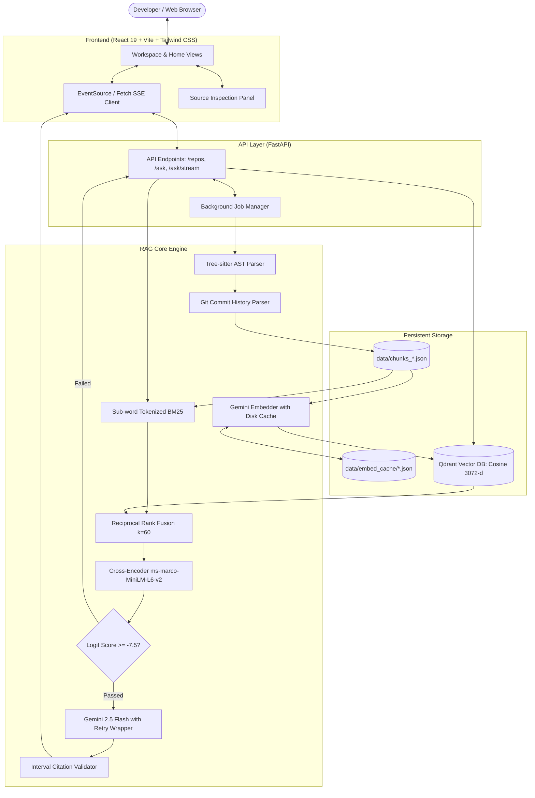

# Codebase Assistant — Architectural Overview

This document details the system design, components, and data pipeline of **Codebase Assistant**.

For the exhaustive all-in-one defense guide, file directory map, and presentation pitch, see [MASTER_PROJECT_GUIDE.md](../MASTER_PROJECT_GUIDE.md).

---

## 1. High-Level Architecture Diagram

---

## 2. Component Specifications

### 2.1 Ingestion & Parsing (`ingest/`)
* **Tree-sitter AST Engine**: Recursively traverses the repository syntax tree. Breaks code into syntactically valid chunks (complete functions and class blocks) rather than fixed-token slices.
* **Metadata Attachment**: Enriches each chunk with repository URL, latest commit SHA, author attribution, and hierarchical context headers.

### 2.2 Storage & Search (`index/` & `retrieve/`)
* **Sub-word BM25**: Splits snake_case, camelCase, and file paths so exact symbol names can be discovered effortlessly.
* **Dense Semantic Vector Store**: Stores 3072-dimensional Gemini embeddings in Qdrant with Cosine distance metric.
* **Reciprocal Rank Fusion (RRF)**: Merges sparse and dense search rankings safely using $k=60$.
* **Cross-Encoder Gating**: Reranks top 20 candidates down to 5 using `cross-encoder/ms-marco-MiniLM-L6-v2`. Any query failing the logit threshold ($\tau = -7.5$) triggers an automatic low-confidence notice, preventing hallucination.

### 2.3 Generation & Citation Verification (`generate/`)
* **Prompt Injection**: Injects top reranked chunks into a markdown-structured prompt with system instructions enforcing `[file:start-end]` citations.
* **Streaming & Retries**: Emits SSE tokens while automatically retrying on 503/429 spikes using exponential backoff.
* **Citation Interval Validator**: Programmatically verifies that every cited line interval exists inside the retrieved chunks before the answer is rendered.

